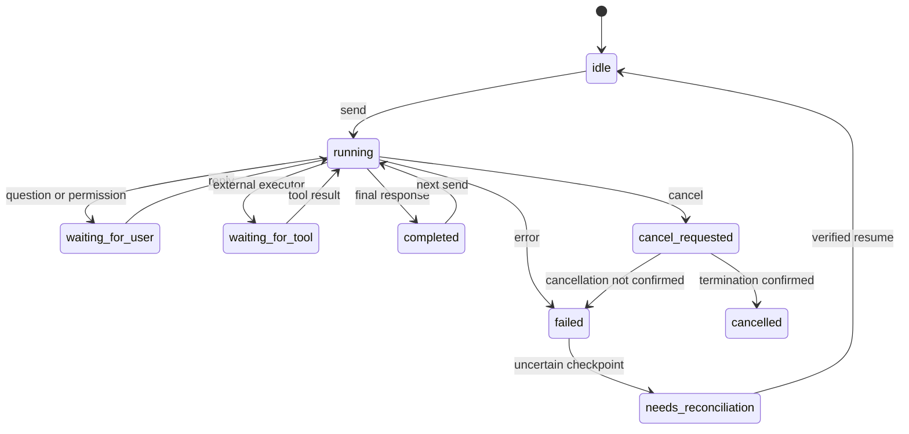

# Предложение внешнего API полноценного чата

Статус: **PROPOSAL, ещё не реализовано**. Имена ниже — проект интерфейса, их нет в текущем tools/list. Основание: [проверенные пути](TECHNICAL_FINDINGS.md) и [эксперименты](EXPERIMENTS.md).

## Цель

Внешний агент должен создавать или продолжать чат, получать ход выполнения, отвечать на вопросы и подтверждения, отменять работу и восстанавливать состояние после разрыва MCP. Сама беседа живёт в облаке Напарника; мост хранит локальную привязку, курсор, журнал событий и состояние незавершённого хода.

Можно сделать чат, которым управляют исключительно MCP-запросы. «Статический» здесь означает постоянный chatId без обязательной открытой панели. Внутри всё равно нужен асинхронный цикл: модель → инструмент → результат → модель → вопрос/финальный ответ.

## Минимальный набор операций

| Инструмент | Основные параметры | Результат |
|---|---|---|
| workmate_chat_create | projectName, skillName, toolPolicy, optional title | chatId, capabilities, revision |
| workmate_chat_send | chatId, message, clientRequestId, expectedRevision | turnId, state; быстро, без ожидания всей генерации |
| workmate_chat_status | chatId, optional turnId | state, revision, cursor, pending interaction, error |
| workmate_chat_events | chatId, afterCursor, limit, waitSeconds | события, nextCursor, hasMore; bounded long poll |
| workmate_chat_reply | chatId, interactionId, response, clientRequestId, expectedRevision | продолжение существующего хода |
| workmate_chat_cancel | chatId, turnId | cancel_requested; затем отдельное cancelled либо error |
| workmate_chat_list | projectName, limit, cursor | локально известные чаты и возможность восстановления |
| workmate_chat_resume | chatId | проверенное состояние курсора или needs_reconciliation |
| workmate_chat_capabilities | optional chatId | поддерживаемые функции адаптера, версии, локальные tools, состояние server catalog |

create может создавать только локальную запись и создавать облачную беседу при первом send. Это должно явно отражаться в state, без вымышленного conversationId.

## Идентификаторы и атомарность

- chatId — устойчивый ID моста, не HTTP Mcp-Session-Id и не JShell alias.
- conversationId/replyToMessageUuid — native сессия; обновляются только после подтверждённого результата/контрольной точки.
- turnId — один пользовательский ход, включая инструменты и продолжения.
- interactionId — конкретный вопрос, разрешение либо внешний tool request.
- clientRequestId — ключ повторного запроса: тот же ключ и то же тело возвращают предыдущий результат; другое тело с тем же ключом — конфликт.
- revision — защита от одновременного send и смены курсора; одна активная генерация на чат.
- event cursor — монотонный локальный номер; доставка с возможным повтором, клиент дедуплицирует по eventId.

Повтор HTTP после timeout не должен создавать новую беседу или повторять изменение. Для mutation tools нельзя обещать exactly-once только за счёт записи моста: нужны идемпотентность исполнителя либо состояние execution_unknown с ручным/предметным разрешением.

## Состояния



completed — статус хода, не закрытие чата. Пустой текст сам по себе не completed. Истечение времени ожидания клиента не переводит серверную работу в cancelled.

## События и вопросы

Минимальный event envelope:

```json
{
  "eventId": "evt-42",
  "cursor": 42,
  "chatId": "chat-local-id",
  "turnId": "turn-local-id",
  "type": "interaction.required",
  "revision": 7,
  "payload": {
    "interactionId": "question-1",
    "kind": "choice",
    "text": "Какой объект исследовать?",
    "options": [{"id": "catalog", "label": "Справочник"}],
    "allowFreeText": true
  }
}
```

Типы: turn.started, assistant.text.delta, assistant.message, tool.started, tool.finished, interaction.required, turn.completed, turn.failed, cancellation.requested, turn.cancelled, session.reconciled. Не экспортировать скрытые рассуждения модели, токены или сетевые заголовки. Инструментальные результаты ограничивать по размеру; для больших данных — безопасная ссылка на ресурс.

permission должна включать точное действие, параметры, область изменения и варианты approve/reject. Обычное «да» в новом send не заменяет ответ на идентифицированное подтверждение. Пока native адаптер не умеет доставать карточки, capability structuredInteractions=false и явная ошибка unsupported; не изображать рабочую функцию на основании текстового вопроса.

## Инструменты и свои исполнители

Три независимых канала: родные локальные IMcpTool; команды EDT-MCP через bridge; серверные tools. Объявление схемы и выполнение — разные операции. allowedTools в исследованной реализации фильтрует объявления, а не обеспечивает запрет исполнения.

Для MVP достаточно заранее установленных локальных обработчиков с реальной проверкой policy непосредственно перед call. Следующий этап — OSGi service/extension point, который отдаёт specification и executor. Не менять singleton посредством reflection; собрать контролируемый IMcpTools wrapper/реестр.

Внешний исполнитель за пределами EDT — отдельная, необязательная фаза:

1. workmate_tool_register объявляет схему, owner, scope, TTL и execution policy.
2. Модель вызывает tool → bridge публикует tool.execution.requested с callId, arguments и deadline.
3. Клиент получает событие через events и отправляет workmate_tool_result(callId, result/error, clientRequestId).
4. Bridge проверяет owner/schema/срок и возвращает результат в native диалог с исходным tool_call_id.

В эксперименте такого сетевого callback не было: custom IMcpTool выполнялся прямо в JVM. Указанная регистрация — новая разработка. Потерянный внешний исполнитель должен давать timeout/error, а не вечное ожидание UI thread.

Нельзя отклонять все неизвестные локальному реестру имена: так работают серверные tools. Сначала определить маршрут. accepted означает передачу серверу, а не successful local execution. SERVER_TOOLS из четырёх исторических имён недостаточно для allowlist реального облачного набора.

## Сохранение и совместное использование с панелью

Сохранять chat metadata, актуальный native cursor, безопасные сообщения/события, state, параметры незавершённых взаимодействий и tool checkpoints. Не сохранять учётные данные облака: использовать штатные сервисы плагина.

После restart загрузить локальные записи, проверить доступность проекта/версии адаптера/сессии, затем reconcile. До этой проверки не отправлять сообщение по старому reply UUID. Если штатная панель продвинула беседу и получить облачный head невозможно, вернуть needs_reconciliation и предложить явную ветку/импорт; не выбирать молча.

Отдельный чат на агент снижает конфликты. Открытие того же conversationId в панели полезно, но требует проверки head до следующего MCP send.

## Стабильность и критерии готовности

Версионируемый адаптер по версиям bundle; feature detection доступных методов; явный unsupported_version. Управляемый executor, ограничения одновременных ходов и количества событий; очистка listener/Future при disposal. SWT/FX применяются только там, где этого требует локальный инструмент или панель, сеть не блокирует UI.

Полноценный чат готов только после тестов: 2 хода с контекстом; вопрос и ответ на карточку; approve и reject; native и серверный tools; custom tool; отмена; reconnect; restart/resume; UI-конкуренция; отрицательная/нулевая delta; лимит раундов; повтор одинакового clientRequestId без двойного изменения. Одноразовый ask_workmate не должен ломаться после добавления нового API.
